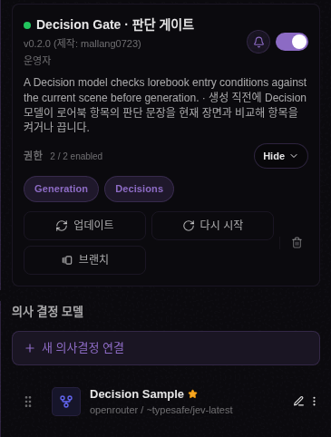
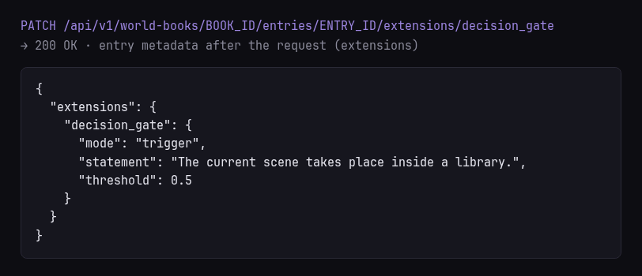

# Decision Gate (판단 게이트)

**Requires a Lumiverse build that includes the Decision API (`decisions-v1`): any build from 2026-10-11 or later — e.g. the current ghcr.io `latest` Docker image or staging/1.3.0. The tagged v1.2.5 release from 2026-10-09 does not include it; later builds may still show 1.2.5 as the version.**

Decision Gate reproduces Marinara's lorebook “decision activation”: a Decision model checks entry conditions against the recent scene during prompt assembly, enabling situational lore beyond keywords. Extension **0.2.0** · `decision_gate_lv`.

## Features

- **`trigger`:** passing requests activation for this prompt; failing leaves normal activation rules unchanged.
- **`require`:** failing blocks the entry for this prompt; passing leaves normal rules unchanged, without forcing activation.
- Opt-in entries are evaluated together in one `noul` (numeric truth score) request, with up to 50 results cached in memory.
- No model call for queries, disabled processing, no valid opted-in entries, or an empty scene.

## Compatibility and installation

The API (`spindle.decisions.evaluate`) arrived in commit `6d6a921b` (“Add TypeSafe + OR Decision model support”). Production use is confirmed on ghcr.io `latest` from `3d741483` (**2026-10-24**), still reporting **1.2.5**. Installation does not check API availability.

1. Open the Lumiverse drawer → **Extensions → Install from Source**, then install:

   ```text
   https://github.com/mallang0723/LV-DecisionGate
   ```

2. Grant both permissions:
   - **`generation`** — adjusts lorebook activation during prompt assembly.
   - **`decisions`** — evaluates conditions through the configured Decision model.
3. Enable **Decision Gate · 판단 게이트**. If permissions were granted after startup, disable and re-enable it.
4. In **Connections → Decision Models**, configure a default `noul`-capable model and credentials (or set `connection_id` below). A chat connection alone is insufficient.



## Usage and entry fields

1. Export a lorebook backup, attach the book to an active chat/character source, and leave the target entry enabled.
2. Merge this **entry metadata fragment** into `extensions`, preserving other fields. Do not paste it into lore text:

   ```json
   {
     "extensions": {
       "decision_gate": {
         "mode": "trigger",
         "statement": "The current scene takes place inside a library.",
         "threshold": 0.5
       }
     }
   }
   ```

3. There is no entry editor. Replace the IDs and use this authenticated REST request on your Lumiverse instance (`value` is required):

   ```http
   PATCH /api/v1/world-books/BOOK_ID/entries/ENTRY_ID/extensions/decision_gate
   Content-Type: application/json

   { "value": { "mode": "trigger", "statement": "The current scene takes place inside a library.", "threshold": 0.5 } }
   ```

4. Send a non-greeting scene message and generate. A score ≥ `0.5` requests activation; use `require` to block on a failed condition instead.

| Field | Meaning |
|---|---|
| `mode` | Required: `"trigger"` or `"require"`; their behavior differs as described above. |
| `statement` | Required, nonempty condition string; surrounding whitespace is removed. |
| `threshold` | Optional number, default `0.5`. Passes at `score >= threshold`; numbers are clamped to `0–1`, invalid values use the default. |

Disabled entries and invalid configurations are skipped. `decision_gate_lv` is a fallback namespace; an object under `decision_gate` takes precedence.




**Quick self-check:** enable, generate with a configured entry, and check backend logs (`log_decisions: true`). English is the default: startup shows `[decision-gate] ready`, and success looks like `[decision-gate] "Library"=0.69 691ms in=10 out=2 cost=0.001` (usage/cost appear only when available). Missing API causes repeated `failed(error)`; connection/permission errors can also cause it. With `"language": "ko"`, startup shows `준비됨` and failures show `실패(error)`; scores, timing, and usage/cost keep the same format. A `ready`/`준비됨` message alone does not confirm compatibility.

## Settings

Edit `settings.json` in **Spindle storage** (no settings screen). Relative to Lumiverse's data directory:

- Operator installation: `extensions/decision_gate_lv/storage/settings.json`.
- User-scoped installation: `users/<user-id>/extensions/decision_gate_lv/settings.json`.

Ask the server administrator if needed. The extension only reads this file; missing/unreadable settings or invalid types use defaults. One build supports both languages. New installs and existing settings without `language` use English (`"en"`). For Korean logs, add `"language": "ko"` to the existing JSON object, preserving other settings, or create the file with `{ "language": "ko" }`. Changes apply on the next call; disable/re-enable to see the startup message in the selected language.

| Setting | Default | Effect |
|---|---|---|
| `language` | `"en"` | Log language: `"en"` or `"ko"`; missing or invalid values use English. |
| `enabled` | `true` | `false` bypasses processing. |
| `connection_id` | `null` | Default Decision connection; supply a nonempty ID to choose another. |
| `history_messages` | `6` | Recent non-greeting messages; rounded/clamped to `1–50`. |
| `timeout_ms` | `6000` | Evaluation timeout; rounded/clamped to `500–9500` ms, below the host's 10-second limit. |
| `fail_open_require` | `false` | On failure, `true` leaves `require` entries to normal activation instead of blocking. |
| `log_decisions` | `true` | Decision/cache logs; startup and unexpected-error logs may remain when `false`. |

## Failure behavior, backups, and undo

Only prompt-local activation changes. Saved lore, keywords, enabled flags, chats, characters, presets, and credentials stay untouched; manual edits persist.

- **Evaluation error, timeout, invalid/missing answer, or empty scene:** `trigger` makes no override; `require` blocks unless `fail_open_require` is `true`.
- **Unexpected interceptor error or host timeout:** processing is skipped; `require` blocking is not guaranteed.
- **Undo:** disable the extension to stop its interceptor. Remove metadata with `{"value": null}` at the same PATCH endpoint (also remove the fallback namespace if used). No automatic backups or undo history: export the book and copy settings before editing.

## FAQ

1. **It shows 1.2.5?** Check the build date: the **2026-10-09 tag** lacks the API; builds with the **2026-10-11** addition work. Use the log check above.
2. **No scores, or repeated failures?** Check active book/entry, valid metadata, both permissions, `enabled`, logging, Decision connection/credentials, and timeout. Queries, greetings-only scenes, and cache hits do not produce fresh scores.
3. **Low score but active, or high score but absent?** Failed `trigger` does not block ordinary activation; successful `require` does not force it. Host selection/budgets and other extensions still apply.
4. **Same result after editing?** Excluded/truncated text changes or changing the model within one connection may reuse cached results. Disable/re-enable to clear the cache.

## Privacy and limitations

- Metadata: Lumiverse database. Settings: extension storage. Results: worker memory (up to 50); no scene/result archive is written.
- Backend logs include entry names/IDs, scores, timing, failure categories, and numeric usage/cost if available—not chat bodies, statements, or provider error bodies. Server logging controls retention; avoid sensitive entry names or disable decision logs.
- **Model calls send processed recent text and statements, keyed by entry IDs, through Lumiverse to your Decision provider.** Its data handling and charges apply. There is no separate telemetry destination; credentials remain managed by Lumiverse.
- Input excludes greetings, matching `wi-exclude` tag blocks, and `<details>` blocks. It keeps the last 1,500 characters per message and at most 8,000 overall. Images, full chat history, and entry lore content are not submitted.
- Only host-supplied entries are considered. The host limit is **256 questions per request**; batches are not split, and provider limits may be lower. Evaluation adds latency, and model judgments can be wrong.
- No dedicated UI or automatic Marinara import. Failed calls may retry; individual missing answers can still yield cached failure-policy results.

## Changelog and credits

**0.2.0:** one build with English/Korean logs selected by `language` (default `"en"`), bilingual extension metadata, and unchanged numeric log formatting.

**0.1.1:** scene-based caching reflects edits/deletions in processed history; empty scenes skip calls; numeric usage/cost is logged when available. Inspired by Marinara's lorebook decision activation.

---

# 한국어

**Decision API(`decisions-v1`)가 포함된 Lumiverse 빌드가 필요합니다. 2026-10-11 이후 빌드(당일 포함)를 사용하세요. 예: 현재 ghcr.io `latest` Docker 이미지 또는 staging/1.3.0. 2026-10-09의 v1.2.5 태그 릴리스에는 이 API가 없으며, 이후 빌드도 버전이 1.2.5로 표시될 수 있습니다.**

판단 게이트는 Marinara의 로어북 “판단 활성화”를 재현합니다. 프롬프트 조립 중 Decision 모델이 항목 조건을 최근 장면과 비교해, 키워드만으로 표현하기 어려운 상황의 로어를 활성화합니다. 확장 **0.2.0** · `decision_gate_lv`.

## 기능

- **`trigger`:** 통과하면 해당 프롬프트에서 활성화를 요청하고, 실패하면 기존 활성화 규칙을 유지합니다.
- **`require`:** 실패하면 해당 프롬프트에서 차단하고, 통과하면 강제 활성화 없이 기존 규칙을 유지합니다.
- 설정한 항목들을 `noul`(숫자로 된 참 판단 점수) 요청 하나로 묶어 평가하고, 결과를 메모리에 최대 50개 캐시합니다.
- 조회 요청, 처리 비활성화, 유효한 대상 항목 없음, 빈 장면에서는 모델을 호출하지 않습니다.

## 호환성과 설치

API(`spindle.decisions.evaluate`)는 커밋 `6d6a921b`(“Add TypeSafe + OR Decision model support”)에서 추가됐습니다. 버전이 **1.2.5**로 표시되는 `3d741483` 기반 ghcr.io `latest`(**2026-10-24**)에서 실제 운영 동작이 확인됐습니다. 설치 시 API 제공 여부는 검사하지 않습니다.

1. Lumiverse 서랍 메뉴 → **Extensions(확장) → Install from Source(소스에서 설치)**에서 아래 URL로 설치합니다.

   ```text
   https://github.com/mallang0723/LV-DecisionGate
   ```

2. 두 권한을 허용합니다.
   - **`generation`** — 프롬프트 조립 중 로어북 활성화를 조정합니다.
   - **`decisions`** — 설정한 Decision 모델로 조건을 평가합니다.
3. **Decision Gate · 판단 게이트**를 활성화합니다. 시작 후 권한을 허용했다면 껐다가 다시 켭니다.
4. **Connections(연결) → Decision Models(Decision 모델)**에서 인증 정보와 `noul` 지원 모델을 설정하고 기본 연결로 지정합니다(또는 아래 `connection_id` 사용). 일반 채팅 모델 연결만으로는 부족합니다.


## 사용 방법과 항목 필드

1. 로어북을 내보내 백업한 뒤 활성 채팅·캐릭터 소스에 연결하고, 대상 항목을 켜 둡니다.
2. 아래 **항목 메타데이터 일부**를 병합하되 다른 `extensions` 필드는 보존합니다. 로어 본문에 붙여 넣지 마세요.

   ```json
   {
     "extensions": {
       "decision_gate": {
         "mode": "trigger",
         "statement": "The current scene takes place inside a library.",
         "threshold": 0.5
       }
     }
   }
   ```

3. 항목 편집 화면은 없습니다. ID를 바꾸고 사용 중인 Lumiverse에 인증된 REST 요청을 보냅니다(`value` 필수).

   ```http
   PATCH /api/v1/world-books/BOOK_ID/entries/ENTRY_ID/extensions/decision_gate
   Content-Type: application/json

   { "value": { "mode": "trigger", "statement": "The current scene takes place inside a library.", "threshold": 0.5 } }
   ```

4. 인사말이 아닌 장면 메시지를 보내고 생성합니다. 예시는 도서관 장면을 뜻하며, 점수 ≥ `0.5`이면 활성화를 요청합니다. 조건 실패 시 차단하려면 `require`를 쓰세요.

| 필드 | 의미 |
|---|---|
| `mode` | 필수: `"trigger"` 또는 `"require"`. 동작 차이는 위 설명을 참고하세요. |
| `statement` | 필수: 비어 있지 않은 조건 문자열. 앞뒤 공백은 제거합니다. |
| `threshold` | 선택 숫자, 기본값 `0.5`. `score >= threshold`이면 통과합니다. 숫자는 `0–1`로 보정하고 잘못된 값은 기본값을 사용합니다. |

비활성 항목과 잘못된 설정은 건너뜁니다. `decision_gate_lv`도 대체 네임스페이스로 읽으며, `decision_gate`의 객체가 우선합니다.


**빠른 자가 점검:** 활성화 후 설정한 항목으로 생성하고 백엔드 로그를 확인하세요(`log_decisions: true`). 기본 언어는 영어입니다. 시작 시 `[decision-gate] ready`, 성공 시 `[decision-gate] "Library"=0.69 691ms in=10 out=2 cost=0.001`처럼 표시됩니다(사용량·비용은 반환된 경우에만 표시). API가 없으면 `failed(error)`가 반복되며, 연결·권한 오류도 같은 메시지를 낼 수 있습니다. `"language": "ko"`이면 시작 문구는 `준비됨`, 실패 문구는 `실패(error)`이며 점수·시간·사용량·비용 형식은 동일합니다. `ready`/`준비됨`만으로는 호환성을 확인할 수 없습니다.

## 설정

전용 설정 화면은 없습니다. 확장의 **Spindle 저장 공간**에서 `settings.json`을 편집합니다. Lumiverse 데이터 디렉터리 기준 상대 경로:

- 운영자 범위 설치: `extensions/decision_gate_lv/storage/settings.json`.
- 사용자 범위 설치: `users/<user-id>/extensions/decision_gate_lv/settings.json`.

서버 관리자가 편집해야 할 수 있습니다. 확장은 파일을 읽지만 직접 만들지는 않습니다. 설정이 없거나 읽을 수 없거나 필드 타입이 잘못되면 기본값을 사용합니다. 하나의 빌드에서 두 언어를 지원하며, 신규 설치와 `language` 키가 없는 기존 설정은 영어(`"en"`)를 사용합니다. 한국어 로그를 쓰려면 다른 설정을 유지하면서 기존 JSON 객체에 `"language": "ko"`를 추가하거나, 파일이 없다면 `{ "language": "ko" }`로 만드세요. 다음 호출부터 반영되며, 시작 문구도 확인하려면 확장을 껐다 켜세요.

| 설정 | 기본값 | 효과 |
|---|---|---|
| `language` | `"en"` | 로그 언어: `"en"` 또는 `"ko"`. 누락되거나 잘못된 값이면 영어를 사용합니다. |
| `enabled` | `true` | `false`이면 처리를 건너뜁니다. |
| `connection_id` | `null` | 기본 Decision 연결. 다른 연결을 쓰려면 비어 있지 않은 ID를 지정합니다. |
| `history_messages` | `6` | 인사말을 제외한 최근 메시지 수. 반올림 후 `1–50`으로 제한합니다. |
| `timeout_ms` | `6000` | 평가 제한 시간. 반올림 후 `500–9500`ms로 제한하며 호스트의 10초 제한보다 짧습니다. |
| `fail_open_require` | `false` | 실패 시 `true`이면 `require` 항목을 차단하지 않고 기존 활성화 규칙에 맡깁니다. |
| `log_decisions` | `true` | 판단·캐시 로그. `false`여도 시작·예상치 못한 오류 로그는 남을 수 있습니다. |

## 실패 동작, 백업, 되돌리기

변경은 해당 프롬프트의 활성화에만 적용됩니다. 저장된 로어 본문, 키워드, 활성화 상태, 채팅, 캐릭터, 프리셋, 인증 정보를 다시 쓰지 않습니다. 직접 편집한 메타데이터·설정은 남습니다.

- **평가 오류, 시간 초과, 잘못되거나 누락된 답변, 빈 장면:** `trigger`는 변경하지 않고, `require`는 `fail_open_require`가 `true`가 아닌 한 차단합니다.
- **예상치 못한 인터셉터 오류 또는 호스트 시간 초과:** 처리를 건너뛰며, `require`의 차단을 보장하지 않습니다.
- **되돌리기:** 확장을 끄면 인터셉터가 해제됩니다. 같은 PATCH API에 `{"value": null}`을 보내 메타데이터를 제거합니다(대체 네임스페이스도 사용했다면 제거). 자동 백업·Undo 기록은 없으므로 편집 전 로어북을 내보내고 설정을 복사하세요.

## FAQ

1. **1.2.5라고 표시되면 호환되지 않나요?** **2026-10-09 태그**에는 API가 없습니다. **2026-10-11** 추가 사항을 포함한 빌드도 1.2.5로 표시될 수 있습니다. 위 로그 자가 점검을 사용하세요.
2. **점수가 없거나 실패가 반복되나요?** 활성 로어북·항목, 유효한 메타데이터, 두 권한, `enabled`, 로그 설정, Decision 연결·인증 정보, 제한 시간을 확인하세요. 조회, 인사말만 있는 장면, 캐시 적중 시에는 새 점수가 나오지 않습니다.
3. **낮은 점수인데 켜지거나 높은 점수인데 안 나오나요?** `trigger` 실패는 일반 활성화를 막지 않고, `require` 성공은 강제 활성화하지 않습니다. 호스트의 선택·예산 규칙과 다른 확장도 영향을 줍니다.
4. **편집해도 결과가 같나요?** 제거·잘림 대상 텍스트나 같은 연결 안의 모델을 바꾸면 캐시를 재사용할 수 있습니다. 확장을 껐다 켜면 캐시가 지워집니다.

## 데이터 처리와 제한사항

- 메타데이터는 Lumiverse 데이터베이스, 설정은 확장 저장 공간, 결과는 워커 메모리(최대 50개)에 남습니다. 장면·결과 기록 파일은 쓰지 않습니다.
- 백엔드 로그에는 항목 이름·ID, 점수, 시간, 실패 분류, 반환된 숫자형 사용량·비용이 포함됩니다. 대화 본문·판단 문장·공급자 오류 본문은 기록하지 않습니다. 보관은 서버 로그 설정에 따르며, 민감한 항목 이름을 피하거나 판단 로그를 끄세요.
- **모델 호출 시 가공한 최근 텍스트와 항목 ID를 키로 묶은 판단 문장이 Lumiverse를 통해 설정한 Decision 공급자에게 전송됩니다.** 공급자의 데이터 처리 방침과 요금이 적용됩니다. 별도 사용 통계 전송 대상은 없으며 인증 정보는 Lumiverse가 관리합니다.
- 입력에서 인사말, 일치하는 `wi-exclude` 태그 블록, `<details>` 블록을 제외합니다. 메시지당 뒤쪽 1,500자, 전체 최대 8,000자를 사용합니다. 이미지, 전체 대화 기록, 항목의 로어 본문은 전송하지 않습니다.
- 호스트가 전달한 항목만 평가합니다. 호스트 제한은 **요청당 256개 질문**이며 묶음을 나누지 않습니다. 공급자 제한은 더 낮을 수 있습니다. 평가에 지연이 추가되고 모델 판단은 틀릴 수 있습니다.
- 전용 UI·자동 Marinara 가져오기는 없습니다. 실패한 호출은 이후 프롬프트 조립에서 재시도될 수 있으며, 반환된 답변 맵에 개별 답변이 빠진 경우 실패 정책을 적용한 결과가 캐시될 수도 있습니다.

## 변경 기록과 크레딧

**0.2.0:** 단일 빌드에서 `language` 설정으로 영어·한국어 로그를 선택합니다(기본값 `"en"`). 확장 이름·설명은 두 언어를 함께 표시하며 숫자 로그 형식은 유지합니다.

**0.1.1:** 장면 기반 캐시가 처리 범위 내 편집·삭제를 반영하고, 빈 장면은 호출을 건너뛰며, 숫자형 사용량·비용이 반환되면 기록합니다. Marinara의 로어북 판단 활성화에서 아이디어를 얻었습니다.
